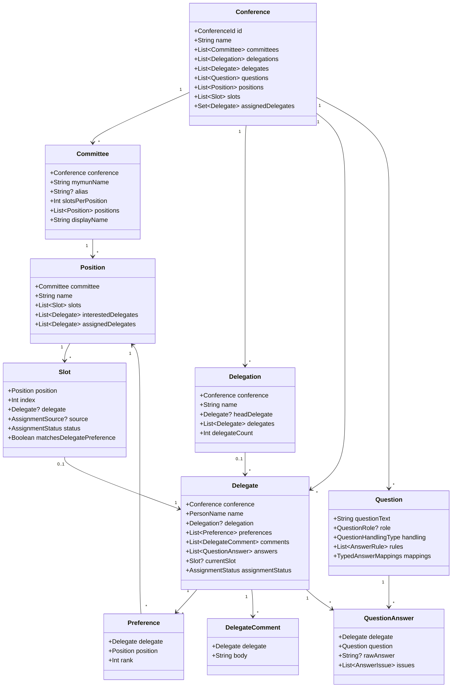

# Domain Model Draft

This draft separates the domain model from the SQLite data model. The domain model is object-oriented, reference-based, and behavior-friendly. The SQLite model is table-oriented and ID-based. Mappers in `:data` translate between them.

This phase still does not implement MyMUN update validation, update persistence, visibility filtering, assignment workflows, or `.munassign` import/export.

## Database Boundary

`docs/DATA_MODEL.md` describes the persistence model. It should be database-friendly: IDs, foreign keys, join tables, lookup tables, and normalized raw text for matching.

This document describes the `:domain` model. It should be pleasant Kotlin:

- Objects reference other objects directly.
- Derived properties expose common concepts such as display names, slot status, current assignment, delegation members, and typed question answers.
- Constructors describe required object graphs and invariants.
- Question behavior is composable: a stable `Question` has editable role, handling, rules, and typed mappings.
- Normalized names are a persistence/search concern unless a domain behavior explicitly needs them.

## Core Types

### Conference

Constructor:

```kotlin
Conference(
    id: ConferenceId,
    name: String,
    committees: List<Committee>,
    delegations: List<Delegation>,
    delegates: List<Delegate>,
    questions: List<Question>,
    createdAt: Instant,
    updatedAt: Instant,
    lastMymunUpdateAt: Instant?
)
```

References:

- Owns committees, delegations, delegates, questions, slots through positions, preferences through delegates, and comments through delegates.

Derived properties:

- `positions: List<Position>` from all committees.
- `slots: List<Slot>` from all positions.
- `assignedDelegates: Set<Delegate>` from slots whose status is `Assigned`.
- `pendingDelegates: Set<Delegate>` from slots whose status is `Pending`.
- `unassignedDelegates: List<Delegate>` from delegates not occupying any slot.
- `openSlots: List<Slot>`, `pendingSlots: List<Slot>`, `assignedSlots: List<Slot>`.

Invariants:

- Name is not blank.
- Child collections must not contain objects from another conference.
- A delegate may occupy at most one slot in the conference.
- UI presentation should sort committees, positions, delegations, and delegates alphabetically unless a later UI feature explicitly adds user-defined ordering.

### Committee

Constructor:

```kotlin
Committee(
    id: CommitteeId,
    conference: Conference,
    mymunName: String,
    alias: String?,
    slotsPerPosition: Int,
    positions: List<Position>
)
```

References:

- References its conference.
- Owns positions.

Derived properties:

- `displayName: String = alias ?: mymunName`.
- `slots: List<Slot>` from positions.
- `openSlotCount`, `pendingSlotCount`, `assignedSlotCount`.

Invariants:

- `mymunName` is not blank.
- `slotsPerPosition >= 1`.
- Committee MyMUN names are unique within a conference, using database/repository normalization.
- `alias` is display-only and never replaces the MyMUN name for update matching.

### Position

Constructor:

```kotlin
Position(
    id: PositionId,
    committee: Committee,
    name: String,
    slots: List<Slot>
)
```

References:

- References its committee.
- Owns slots.

Derived properties:

- `conference: Conference` from `committee.conference`.
- `assignedDelegates: List<Delegate>` from slots.
- `interestedDelegates: List<Delegate>` from conference delegates whose preferences include this position.
- `hasAnyAssignment: Boolean`.

Invariants:

- Name is not blank.
- Position names are unique inside a committee, using database/repository normalization.
- Slot indexes are unique within a position.

Notes:

- MyMUN `Countries.Delegation Name` is not part of the domain position. Delegation context comes through assigned/interested delegates and their delegation.

### Slot

Constructor:

```kotlin
Slot(
    id: SlotId,
    position: Position,
    index: Int,
    delegate: Delegate?,
    source: AssignmentSource?,
    updatedAt: Instant
)
```

References:

- References its position.
- Optionally references the assigned/pending delegate.

Derived properties:

- `conference: Conference` from `position.committee.conference`.
- `status: AssignmentStatus`:
  - `Empty` when `delegate == null`.
  - `Pending` when `delegate != null && source == AssignmentSource.Application`.
  - `Assigned` when `delegate != null && source == AssignmentSource.Mymun`.
- `isEmpty`, `isPending`, `isAssigned`.
- `matchesDelegatePreference: Boolean` by checking whether `delegate` has a preference for `position`.

Enums:

```kotlin
enum class AssignmentSource { Application, Mymun }
enum class AssignmentStatus { Empty, Pending, Assigned }
```

Invariants:

- `index >= 1`.
- `source == null` is only valid when `delegate == null`.
- `source != null` is required when `delegate != null`.
- One delegate can occupy at most one slot in the conference.

Notes:

- There is no `SlotAssignment` domain class. The slot itself has the assigned/pending delegate and assignment source.
- The source enum is intentionally not `Manual`/`Preference`; whether the delegate expressed interest is derived from preferences.

### Delegate

Constructor:

```kotlin
Delegate(
    id: DelegateId,
    conference: Conference,
    name: PersonName,
    email: String?,
    profile: DelegateProfile,
    paymentStatus: PaymentStatus,
    active: Boolean,
    isHeadDelegate: Boolean,
    delegation: Delegation?,
    preferences: List<Preference>,
    comments: List<DelegateComment>,
    answers: List<QuestionAnswer>,
    createdAtFromMymun: Instant?,
    submittedAt: Instant?
)
```

References:

- References its conference.
- Optionally references its delegation.
- Owns preferences, comments, and answers.

Derived properties:

- `displayName`.
- `currentSlot: Slot?` by looking through conference slots.
- `assignmentStatus: AssignmentStatus` from `currentSlot?.status ?: Empty`.
- `currentPosition: Position?` from `currentSlot`.
- `age: Int?` from `profile.dateOfBirth`.
- `applicationSubmittedText` from `submittedAt`.
- `experienceLevel: MunExperienceLevel?` from the configured expected question.
- `highSchoolerStatus: HighSchoolerStatus?` from the configured expected question.
- `languageLevel: LanguageLevel?` from the configured expected question.

Invariants:

- First and last name are not blank.
- Email is not treated as unique.
- `active` is organizer-managed and defaults to true.
- Assignment difficulty is computed by a domain service when needed, not stored on the delegate.

### PersonName

Constructor:

```kotlin
PersonName(firstName: String, lastName: String)
```

Derived properties:

- `displayName = "$firstName $lastName"`.

Normalization for matching belongs in update/database services unless a domain use case needs it.

### DelegateProfile

Constructor:

```kotlin
DelegateProfile(
    country: String?,
    city: String?,
    streetAddress: String?,
    zipCode: String?,
    diet: String?,
    phone: String?,
    nationality: String?,
    dateOfBirth: LocalDate?,
    delegationNameFromMymun: String?,
    applicationStatus: String?
)
```

Notes:

- MyMUN assigned committee/country are not stored here. Current assignment is represented by slots.
- `delegationNameFromMymun` is raw context. The domain relationship is `Delegate.delegation`.

### Delegation

Constructor:

```kotlin
Delegation(
    id: DelegationId,
    conference: Conference,
    name: String,
    country: String?,
    expectedDelegateCount: Int?,
    currentDelegateCountFromMymun: Int?,
    headDelegate: Delegate?,
    delegates: List<Delegate>
)
```

References:

- References its conference.
- References its delegates.
- Optionally references a head delegate.

Derived properties:

- `delegateCount: Int = delegates.size`.
- `displayLabel`, such as name plus country when present.

Invariants:

- Name is not blank.
- Head delegate, when present, must be included in `delegates`.
- Delegation names are unique within a conference, using database/repository normalization.

Delegations are an application feature, not a later nice-to-have. They should be available in delegate detail views and anywhere delegation context helps assignment decisions.

### Preference

Constructor:

```kotlin
Preference(
    id: PreferenceId,
    delegate: Delegate,
    position: Position,
    rank: Int,
    rawPreferenceText: String
)
```

References:

- References its delegate.
- References its position.

Derived properties:

- `committee: Committee` from position.

Invariants:

- `rank > 0`.
- A delegate has at most one preference per rank.
- A delegate has at most one preference for the same position.

### DelegateComment

Constructor:

```kotlin
DelegateComment(
    id: DelegateCommentId,
    delegate: Delegate,
    body: String,
    createdAt: Instant,
    updatedAt: Instant
)
```

References:

- References its delegate.

Invariants:

- Body is not blank.

The database model therefore needs a separate `delegate_comments` table.

## Question Domain Model

Questions are stable domain objects. The database stores question rows, handling type rows, role rows, rule rows, answers, and role-specific mapping rows; the mapper creates one `Question` object with composable configuration.

### Question

Base constructor:

```kotlin
class Question(
    val id: QuestionId,
    val questionText: String,
    val role: QuestionRole?,
    val handling: QuestionHandlingType,
    val visibleInDelegateDetail: Boolean,
    val organizerLabel: String?,
    val rules: List<AnswerRule>,
    val mappings: TypedAnswerMappings
)
```

Base behavior:

- `displayLabel = organizerLabel ?: questionText`.
- `issuesFor(answer: String?): List<AnswerIssue>` by applying all rules.
- `mapMunExperience`, `mapHighSchoolerStatus`, and `mapLanguageLevel` read from role-specific mappings only when the question has the matching expected role.

The question does not reference `Conference`; the conference owns the question list. This keeps the question object reusable inside graph construction and easier to reconfigure.

### Expected Typed Questions

Expected typed roles map raw text answers into role-specific enums with type-safe mapping classes.

```kotlin
data class TypedAnswerMappings(
    val munExperience: List<MunExperienceAnswerMapping>,
    val highSchooler: List<HighSchoolerAnswerMapping>,
    val languageLevel: List<LanguageLevelAnswerMapping>
)
```

Current enum values from the sample workbook:

```kotlin
enum class MunExperienceLevel { FirstTime, Beginner, Intermediate, Advanced }
enum class HighSchoolerStatus { Yes, No }
enum class LanguageLevel { BeginnerA1A2, IndependentUserB1B2, ProficientUserC1C2 }
```

Mapping classes:

```kotlin
data class MunExperienceAnswerMapping(
    val rawValue: String,
    val value: MunExperienceLevel
)

data class HighSchoolerAnswerMapping(
    val rawValue: String,
    val value: HighSchoolerStatus
)

data class LanguageLevelAnswerMapping(
    val rawValue: String,
    val value: LanguageLevel
)
```

This avoids a weak single `ExpectedAnswerValue` bucket where incompatible values are representable.

Default mappings should be available without per-conference setup:

- Experience level: `First Time`, `Beginner`, `Intermediate`, `Advanced`.
- High schooler: `Yes`, `No`.
- Language level: `A1/A2 (Beginner)`, `B1/B2 (Independent User)`, `C1/C2 (Proficient User)`.

Question role and handling are database-backed lookup/configuration rows, but the domain exposes standard constants such as `StandardQuestionRoles.LanguageLevel` and `StandardQuestionHandlingTypes.VisaSupport` so UI code can access expected behavior without stringly typed checks.

### Answer Rules

Rules are domain classes:

```kotlin
sealed interface AnswerRule {
    fun evaluate(answer: String?): AnswerIssue?
}

class MinimumSentenceCount(val count: Int) : AnswerRule
class MinimumTextLength(val length: Int) : AnswerRule
class NoticeWhenNonBlank(val message: String) : AnswerRule
class RequiredAnswer(val message: String) : AnswerRule
```

Rules are composable. For example, a question with `CommitteeChoiceExplanation` handling can have `MinimumSentenceCount(3)` and `MinimumTextLength(...)`.

Answer issues have severity:

```kotlin
enum class AnswerIssueSeverity { Notice, Warning }
```

- `Warning` means the answer may be grounds for rejection or contacting the delegate.
- `Notice` means the answer needs attention but is not a rejection problem, such as visa support being requested.

### QuestionAnswer

Constructor:

```kotlin
QuestionAnswer(
    id: QuestionAnswerId,
    delegate: Delegate,
    question: Question,
    rawAnswer: String?
)
```

Derived properties:

- `issues` from `question.issuesFor(rawAnswer)`.
- Delegate helpers return `MunExperienceLevel`, `HighSchoolerStatus`, or `LanguageLevel` from the configured expected question roles.

## Database Shape For Questions

Question handling should be table-driven because roles and handling behaviors may change across versions.

Suggested tables:

- `question_roles`: known roles such as `experience_level`, `high_schooler_status`, `language_level`.
- `question_handling_types`: known handling types such as `default`, `committee_choice_explanation`, `visa_support`.
- `delegate_questions`: imported question text, selected role, selected handling type, visibility, label.
- `answer_rule_types`: known rule classes such as `minimum_sentence_count`, `minimum_text_length`, `notice_when_non_blank`, `required_answer`.
- `delegate_question_rules`: join/config table from question to rule type, with rule parameters.
- `mun_experience_answer_mappings`: raw value to `MunExperienceLevel`.
- `high_schooler_answer_mappings`: raw value to `HighSchoolerStatus`.
- `language_level_answer_mappings`: raw value to `LanguageLevel`.
- `delegate_question_answers`: raw answers per delegate/question.

Roles and handling types are lookup/configuration tables in the database, and in the domain they are composable value objects with standard constants for UI access.

## Mermaid Domain Graph



## Domain Invariants To Test First

- Conference, committee, position, delegation, question, and comment names/text cannot be blank where required.
- Committee slot count cannot be lower than one.
- Committee aliases do not affect MyMUN matching.
- Slot indexes are positive and unique per position.
- `Slot.status` is always derived from `delegate` and `source`.
- A slot with no delegate is empty regardless of stored/persisted source.
- A slot with a delegate must have an assignment source.
- One delegate can occupy at most one slot in a conference.
- Preference ranks are positive integers and unique per delegate.
- Each expected typed question role appears at most once per conference.
- Typed answer mappings are role-specific and cannot map language values into experience values, or similar.
